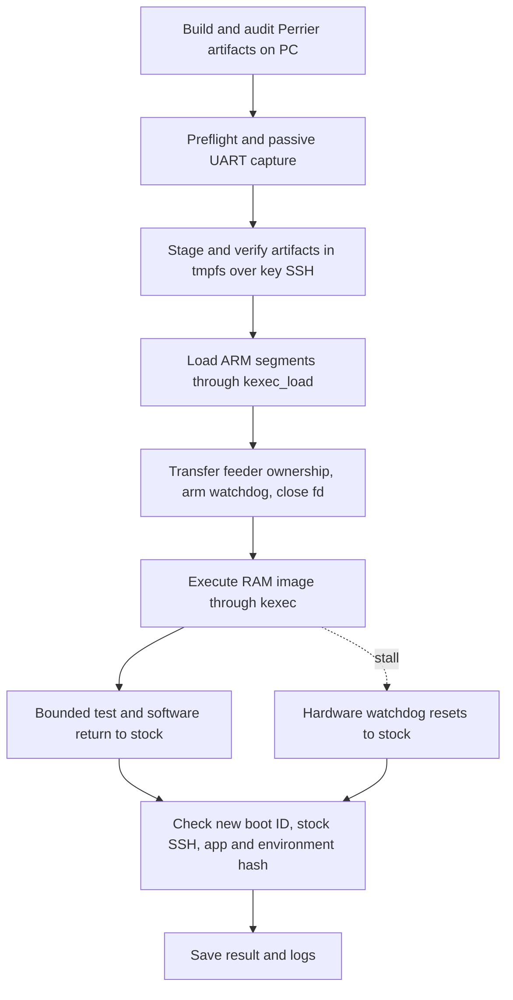

# Touch 10 development and test workflow

The owner's 2026-11-08 request starts development and asks for ordinary tests
without cable cycling or repeated passwords. The existing SSH key is the
normal device control path. Host setup and one normal software reboot have
been exercised. Kexec entry into a reviewed RAM payload, automatic watchdog
recovery, and a minimal Linux 6.18.48 Perrier kernel are now live-tested. A
separate one-shot U-Boot path has also booted a minimal 6.18.48 image from
both software reset and physical power-on. Ram60 now boots the full RAM
environment through U-Boot with Ethernet/root SSH and proven hardware
watchdog recovery. U-Boot is the default kernel-test route requested by the
owner; Qt and other userspace changes use live RAM SSH. The ordinary kexec
runner remains available for specific diagnostics.

## Working commands

Run as `marius`, from `/home/marius/ext_proj/touch10`:

```sh
python3 tools/touch10_dev.py doctor
python3 tools/touch10_dev.py reboot-stock
python3 tools/touch10_dev.py capture --seconds 600
```

`doctor` checks the dedicated Ethernet service, address/carrier, user UART
access, pinned key-only root SSH, kernel/application identity, and the known
normal-boot environment hash. It does not send serial input. `reboot-stock`
starts passive serial capture first, requests **one** ordinary software
reboot, then waits up to ten minutes for a different boot ID, the original
hostname/kernel, and the running factory `phoenix` process. It verifies that
the environment hash stayed unchanged. It never retries reboot or escalates
to a forced reset on a timeout. The runner serializes tests with a file lock.

Each run has a private directory under `development/runs/` containing
`result.json`, raw UART bytes, a timestamped serial log, and SSH diagnostics.
No password is stored in the runner or host services. Failed runs retain
their logs and return a nonzero exit status.

For routine kernel testing, after building and auditing the selected image:

```sh
python3 tools/touch10_uboot.py prepare
python3 tools/touch10_uboot.py session --minutes 30
```

The default is ram60's `cold-ethernet` profile. `prepare` creates and audits a
fresh one-use candidate on the PC. `session` stages the files, writes/readbacks
p8 once, software-reboots through U-Boot, renews the RAM watchdog lease, and
verifies factory return. Kexec is not a prerequisite for each image. See the
[current U-Boot record](development/perrier-cold-ethernet/README.md) for the
live proof and remaining cold touch/display work.

## Host setup installed once

- Existing `touch10-direct-isolated` NetworkManager profile now autoconnects
  on `enp7s0` with `10.77.10.1/24` and no default gateway.
- `touch10-dev-dhcp.service` leases `10.77.10.10` only to this panel's MAC,
  binds exclusively to `enp7s0`, and supplies no DNS service/default route.
  It runs with a dynamic unprivileged user and limited network capabilities.
- An exact-serial-number udev rule gives the active desktop user access to
  the FT230X UART. An ACL was also applied immediately to the connected UART.
- SSH uses the existing dedicated key and pinned host key; the runner forces
  `BatchMode=yes` and `StrictHostKeyChecking=yes`.

Reviewed source files are in [`development/host/`](development/host/). On a
new PC/install, the installer needs one host administrator authentication:

```sh
sudo bash development/host/install.sh
```

Normal commands above require neither host sudo nor a panel password. Host
setup can be removed using `sudo bash development/host/uninstall.sh`.
Persistence through another PC restart/cable reconnect has not been live
tested yet; the profile, service and udev rule are installed persistently.

## Confirmed live baseline

The [controlled reboot result](development/runs/20261108T082341Z-reboot-stock-930ad1/result.json)
passed on 2026-11-08 in about 62 seconds. UART captured PPA, MLO, U-Boot,
kernel startup and login. Key-only SSH returned on a different boot ID with
Linux `3.4.113+` and `phoenix` running. P8 SHA-256 before and after was
`f0fefd27f1ca21360dfe437919e03c5a6ee4c119df3e6070301a8f3879d181ad`.
No manual power cycle, serial command, panel login, or boot-environment
write was used. This also observes an ordinary boot of the previously
restored normal-boot environment.

## Qualified RAM entry and watchdog recovery

The [qualification record](evidence/kexec-watchdog-recovery-2026-11-08.md)
contains exact-kernel analysis, artifact hashes, commands and live results.
The static ARM loader can load/unload the factory zImage and initramfs. A
144-byte RAM payload entered through kexec, printed its UART marker, stalled
with interrupts disabled, and was reset automatically by the watchdog after
about 120 seconds. Stock root SSH and `phoenix` returned; p8 stayed unchanged.



The normal kexec shutdown path disables an **open** stock watchdog. The
reviewed sequence terminates the stock feeder, uses the helper's kernel
ioctls to arm 120 seconds, and closes the descriptor. The exact NOWAYOUT
release path leaves the timer running; its shutdown callback then skips
that closed device. This was proven with a separate 15-second close/reset
test before kexec. A detached fallback restarts the stock feeder if the
entry request fails while stock userspace remains alive. No kernel-code
patch, watchdog register write, or persistent boot change is involved.

The runner provides these explicit diagnostics (the latter two reset the
panel deliberately):

```sh
python3 tools/touch10_dev.py kexec-load-check
python3 tools/touch10_dev.py watchdog-close-recovery
python3 tools/touch10_dev.py kexec-watchdog
```

Execution is restricted to pinned helper, loader and stall-image hashes.
`kexec-watchdog` also requires a recorded passing closed-fd recovery test,
and requires both the RAM entry marker and a new stock boot to pass. It
stops after a failed recovery instead of trying resets repeatedly. These
qualification diagnostics do not need to run before every later kernel test.
Build recipes are `development/build-kexec.sh` and `development/ram/build.sh`.

## First new Linux kernel trial

The [Perrier RAM bring-up record](development/perrier/README.md) documents the
verified source, board-limited DTB, embedded initramfs, loader adaptation,
artifact hashes and live results. The minimal Linux 6.18.48 kernel reached
PID 1 over kexec on 2026-11-08. Its initramfs saw no block devices, sampled
the inherited watchdog counter advancing, and was reset back into stock
firmware by the hardware watchdog. The stock kernel, SSH, and `phoenix`
returned on a new boot ID with unchanged p8 hash.

The apparent fast timer was an omitted 32-bit time syscall option in the
minimal config. With `CONFIG_COMPAT_32BIT_TIME=y`, the ARM initramfs reports
a successful one-second sleep and its serial markers appear every five wall
seconds. The watchdog counter advanced by 33,091 ticks during that first
second. The current RAM init requests a software reboot after 15 seconds;
the watchdog stays armed if it fails. The trial command only accepts hashes
in the reviewed artifact manifest and retains the qualified loader separately.

```sh
python3 development/perrier/build.py
python3 development/perrier/audit.py
python3 tools/touch10_dev.py perrier-load-check
python3 tools/touch10_dev.py perrier-trial --timeout 600
```

## One-shot U-Boot cold boot

The [cold-boot workflow](development/perrier-coldboot/README.md) stages a
hash-named zImage and DTB on p14. Its audited 256 KiB p8 candidate changes
only `bootcmd`: on the next boot, U-Boot saves the factory `normalboot` path
before loading the candidate with `bootz`. The test kernel prints serial
markers, waits ten seconds, then reboots. Any returning U-Boot load/boot
command falls through to the unchanged factory boot command.

On 2026-11-10, the minimal `perrier-cold01` image passed both a software-reset
U-Boot test and a physical power-on test. Both runs ended with stock Linux
`3.4.113+`, `phoenix` running, and exact restoration of the original p8 hash.
The [software-reset result](development/runs/20261110T090353Z-coldboot-e2c4a0/result.json)
and [physical-power result](development/runs/20261110T091103Z-coldboot-b56e25/result.json)
include the serial traces and readback checks. The newer
[interactive ram59 image](development/perrier-watchdog/README.md) uses the
mainline OMAP watchdog driver to start WDT2 itself. Its hardware-expiry proof
passed through kexec. The first full-image U-Boot test reached ram59 and the
feeder, then returned stock automatically when missing cold Ethernet setup
prevented SSH. Ram60 added the stock-verified PHY clock, reset lines, and pad
mux through mainline drivers, then passed the U-Boot SSH and hardware-expiry
test. Stock returned after 151.6 seconds, with the original p8 hash restored.
Cold touch initialization and physical LCD/keypad validation remain open.

Routine kernel work now uses the one-shot U-Boot runner and automatic
watchdog recovery. It writes p8 once and checks its return to the factory
environment before the new userspace starts and after recovery. A kernel
hang before the watchdog driver probes may still need one physical power
cycle. The kexec workflow is retained for tests that specifically need it.
